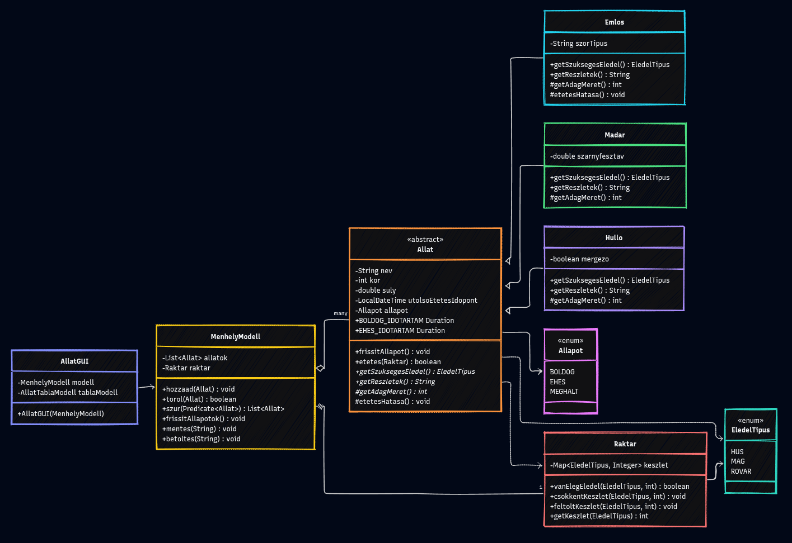

# Fejlesztői dokumentáció

## UML osztálydiagram

## Főbb osztályok és metódusaik

### `Allat` (absztrakt ősosztály)
A rendszer központi modellosztálya, minden állat közös adatait és viselkedését tartalmazza.

- **`frissitAllapot()`** – az utolsó etetés óta eltelt idő alapján állítja az állapotot: a `BOLDOG_IDOTARTAM`-on belül `BOLDOG`, azután az `EHES_IDOTARTAM` végéig `EHES`, azon túl `MEGHALT`. Halott állatot nem éleszt vissza.
- **`etetes(Raktar)`** – `final` template method, ami a közös etetési vázat futtatja (ellenőrzés, raktárból levonás, időbélyeg- és állapotfrissítés), a változó részeket pedig a leszármazottakra bízza. Sikeres etetésnél `true`.
- **`getSzuksegesEledel()`** – absztrakt, minden faj a saját eledeltípusát adja vissza.
- **`getReszletek()`** – absztrakt, rövid, olvasható leírás a faj egyedi tulajdonságairól (a táblázat „Extra" oszlopához).
- **`getAdagMeret()` / `etetesHatasa()`** – a template method beillesztési pontjai: az adagméret és az etetés utóhatása leszármazottanként eltér.
- **`BOLDOG_IDOTARTAM`, `EHES_IDOTARTAM`** – statikus konstansok, amelyek megadják, meddig marad boldog, illetve éhes egy állat.

### `Emlos`, `Madar`, `Hullo` (leszármazottak)
Az `Allat` konkrét megvalósításai, egy-egy egyedi mezővel (`szorTipus`, `szarnyfesztav`, `mergezo`). Mindegyik felülírja a `getSzuksegesEledel()`, `getReszletek()` és `getAdagMeret()` metódusokat, így az etetés viselkedése fajonként eltér: az emlős a súlyából, a madár a szárnyfesztávjából, a hüllő a mérgezőség alapján számol adagot. Az `Emlos` ráadásul az `etetesHatasa()`-ban növeli a súlyt.

### `Raktar`
Az eledelkészletet tartja nyilván eledeltípusonként egy `EnumMap`-ben.

- **`vanElegEledel(tipus, mennyiseg)`** – igaz, ha a kért mennyiség rendelkezésre áll.
- **`csokkentKeszlet(tipus, mennyiseg)`** – levon a készletből, túlvonásnál kivételt dob, így a készlet nem mehet nulla alá.
- **`feltoltKeszlet(tipus, mennyiseg)`** – növeli a készletet.
- **`getKeszlet(tipus)`** – az adott típus aktuális mennyisége.

### `MenhelyModell`
Kezeli az állatok listáját, a raktárat és a fájlműveleteket. A GUI kizárólag ezen keresztül éri el az adatokat.

- **`hozzaad(Allat)` / `torol(Allat)`** – állat felvétele, illetve eltávolítása a nyilvántartásból.
- **`szur(Predicate)`** – a feltételnek megfelelő állatok új listáját adja vissza.
- **`frissitAllapotok()`** – minden állaton meghívja a `frissitAllapot()`-ot.
- **`mentes(fajlNev)` / `betoltes(fajlNev)`** – a teljes állapotot (állatlista + raktár) bináris fájlba írja, illetve visszatölti. A betöltés a meglévő lista- és raktár-referenciákat frissíti, így a GUI által tartott hivatkozások érvényben maradnak.

### `AllatGUI`
A Swing alapú grafikus felület. Két fülből áll: az **Állatok** fülön tábl
zat jeleníti meg az állatokat, fölötte eszköztár az Új állat / Etetés / Törlés gombokkal és a típus/állapot szűrőkkel. A **Raktár** fülön a készletek és a feltöltő gombok láthatók. A menüsor Fájl menüjéből érhető el a mentés és a betöltés. Minden adatműveletet a `MenhelyModell`-re delegál.